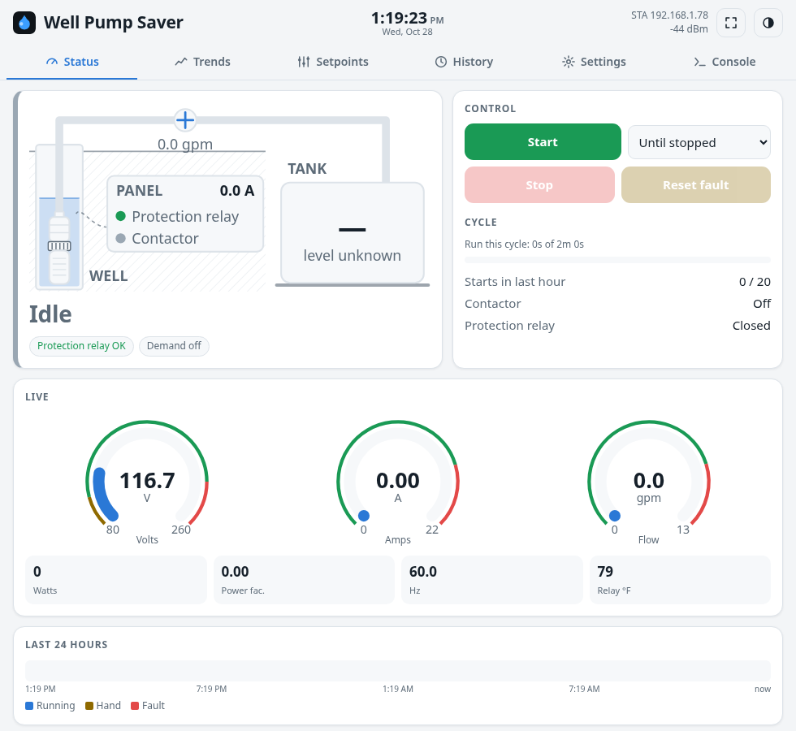
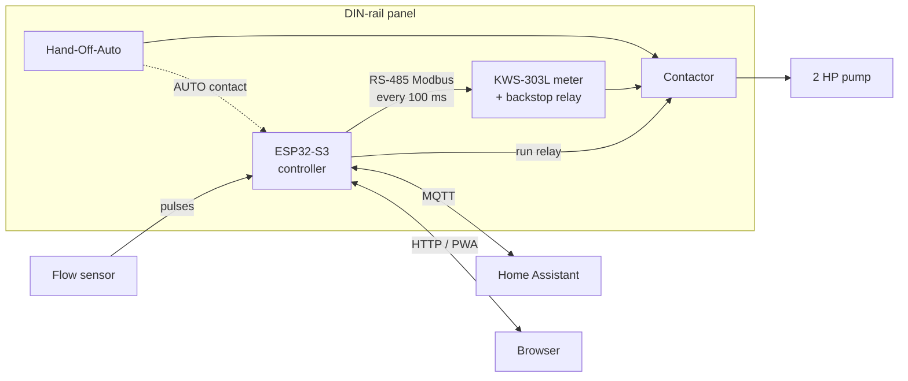
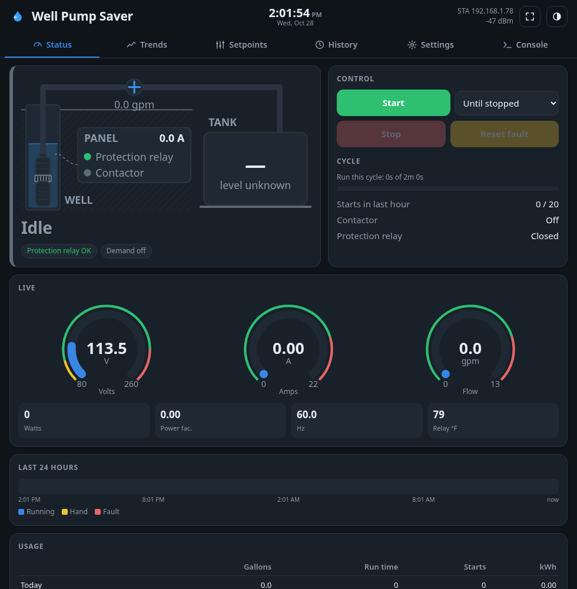
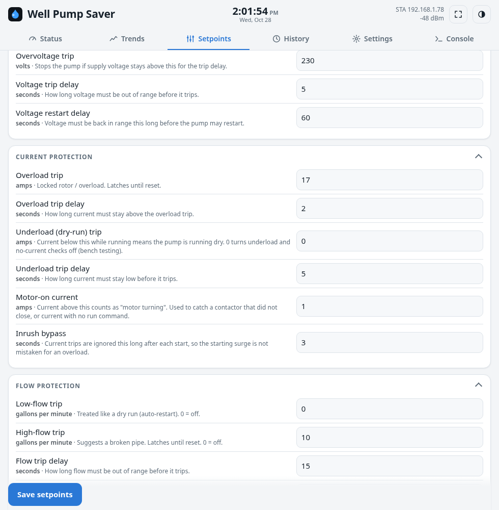
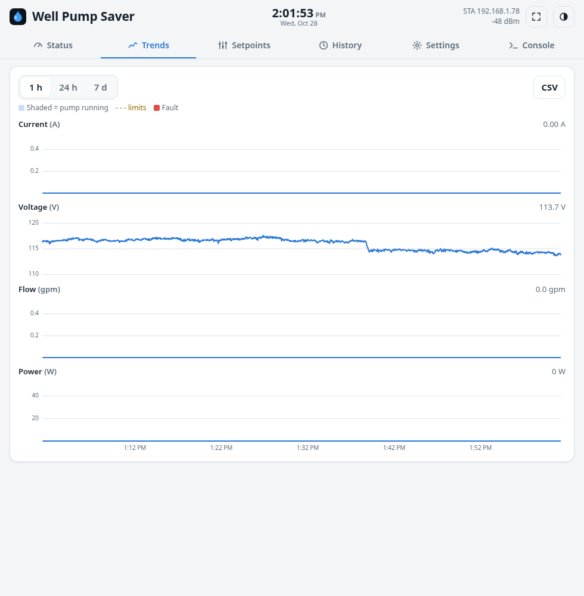
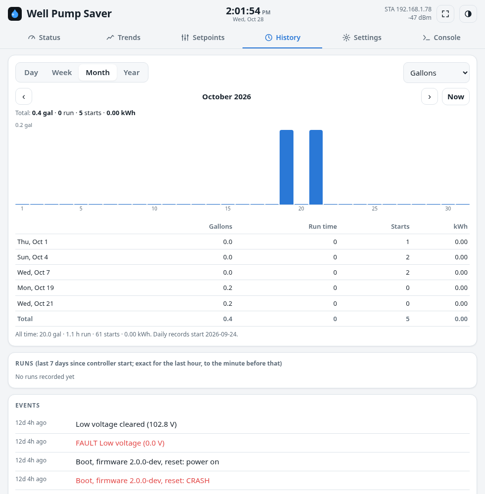
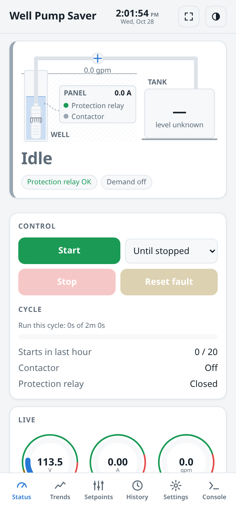
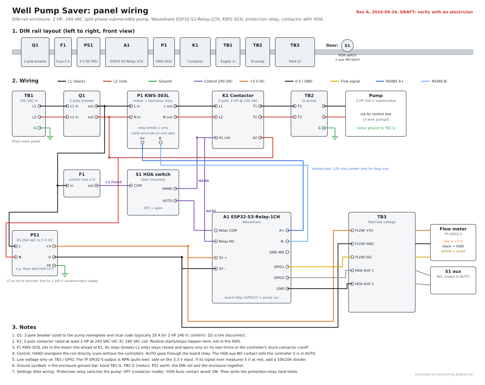

# Well Pump Saver

An ESP32-S3 motor protector and controller for a 2 HP, 240 V submersible well pump. It watches
voltage, current and flow in real time, shuts the pump down before a fault can burn out the
motor, and gives you a web dashboard and Home Assistant integration for the whole water
system.

> **Showcase repository.** The source code for this project is private. This page covers what
> it does, how it's built and what it looks like.

## Why

A submersible pump sits deep in the well, and pulling one to replace it is a big, expensive job.
The usual killers are dry running, short cycling and bad supply voltage, and they do their
damage quietly: nobody notices until the water stops. V1.3 of this controller already existed,
but it could lose setpoints on reboot and got stuck in setup-AP mode after power outages.
V2 is a ground-up rewrite focused on protection you can trust and data you
can see.

## How it works

## What it protects against

- **Dry running / lost prime**: low current or low flow means no water is coming up; stop,
  wait, and retry automatically
- **High current** (locked rotor, failing bearings) and **no current** when the pump should
  be running
- **High flow**: a sudden jump usually means a broken pipe
- **Under- and over-voltage**: blocks starts until the supply recovers
- **Short cycling**: limits starts per hour and enforces cool-down between runs
- **Stuck contactor**: if current keeps flowing after the run signal drops, a backstop relay
  in the power meter opens the motor circuit
- **Lost meter communications**: no valid reading for 3 s is treated as a fault, never as "OK"

Voltage and comms faults clear on their own; dry-run faults restart after a wait; the rest
latch until they are reset from the web UI, Home Assistant or the board's button.

## Features

- Responsive **web dashboard** (phone and desktop, light and dark) with a live system diagram,
  gauges, start/stop controls, cycle timers and a 24-hour run timeline
- **Trends, usage and history**: gallons, run time, starts and kWh, with 5 years of hourly
  records kept on the device
- **Setpoints** for every protection limit, editable from the browser
- **Home Assistant** integration over MQTT with auto-discovery
- Resilient **Wi-Fi**: falls back to a setup access point, then keeps retrying the home
  network, so the controller recovers on its own after a power outage
- **OTA firmware updates** from the browser (`POST /api/update`) and an installable PWA
- Hardware watchdog; the run output defaults to OFF at every boot

## Screens

| | |
|:---:|:---:|
|  |  |
| **Status**, dark theme: live diagram, gauges, control | **Setpoints**: every limit with its plain-English meaning |
|  |  |
| **Trends**: current, voltage, flow and power, with limits overlaid | **History**: day/week/month/year usage, runs and an event log |

 The same dashboard on a phone, installable as a PWA.

Captured from the controller running on the bench (no pump connected, so flow and usage are near zero).

## Hardware

| Part | Role |
|---|---|
| Waveshare **ESP32-S3-Relay-1CH** | Controller; onboard relay drives the contactor coil |
| **KWS-303L** power meter (Modbus RTU over RS-485) | Volts, amps, watts, PF, Hz, temperature, plus a backstop relay |
| 2-pole contactor + Hand-Off-Auto switch | Switches the pump; HAND bypasses the controller |
| **YF-DN32-S** stainless flow sensor | 108 pulses/L flow measurement |
| 5 V DIN-rail PSU, breaker, control fuse | Panel power and protection |

> The wiring diagram (generated from code) is a **draft**.
> This is line-voltage equipment: have an electrician check any panel built from it.

## Status

V2 is feature-complete and running on the bench at 120 V without a pump load; field
installation is next.
